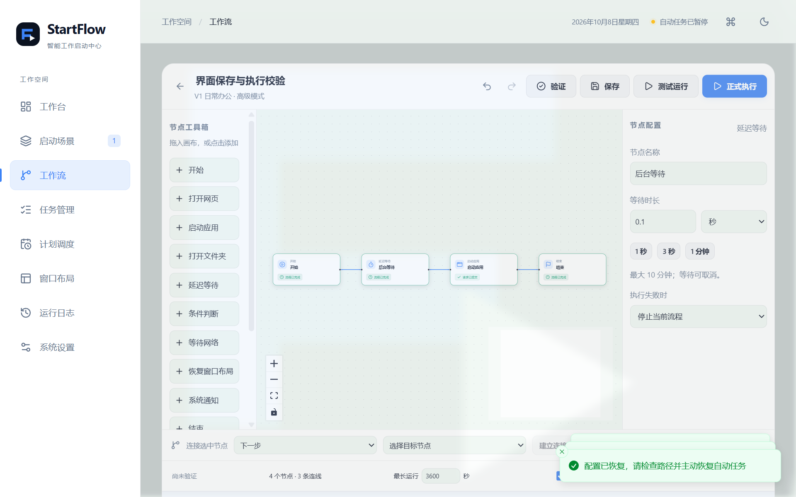
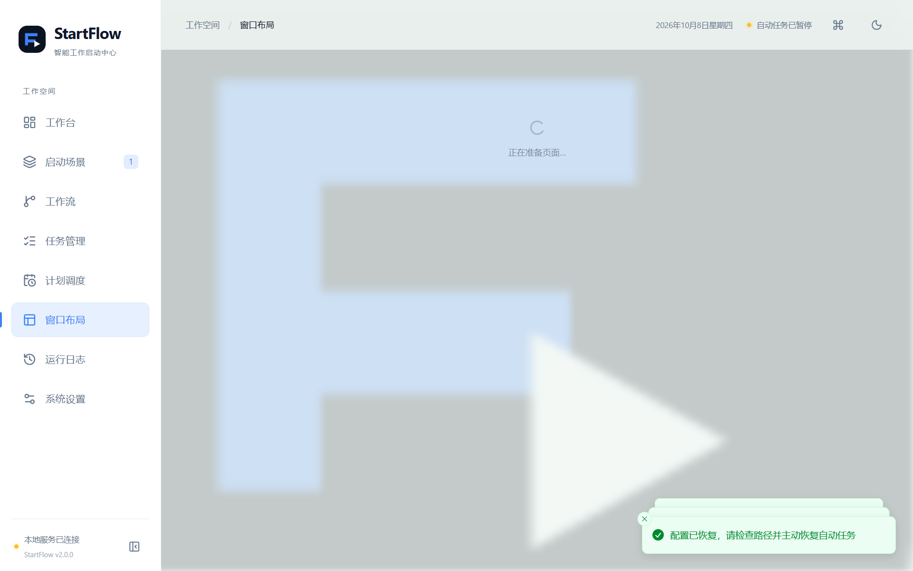

# StartFlow V2 实际构建与测试记录

记录日期：2026-10-08，Windows 11 x64（10.0.26300），本地时区 Asia/Shanghai。Node 24.16.0、Rust 1.99.0、MSVC、WebView2 154。开发沿用 V1 基线，在 `codex/startflow-v2` 分支增量修改。旧 V1 报告保留，其结果没有自动计入本次回归。

## 自动化检查

| 命令 | 实际结果 |
|---|---|
| `npm run build` | TypeScript 严格检查和 Vite 生产构建通过 |
| `npm test` | 13 项通过：8 项原前端测试、5 项 V2 测试 |
| `cargo test --locked --manifest-path src-tauri/Cargo.toml` | 32 项通过：29 项库测试、3 项集成测试 |
| `cargo clippy --locked --manifest-path src-tauri/Cargo.toml --all-targets -- -D warnings` | 通过，无警告 |
| `cargo fmt --manifest-path src-tauri/Cargo.toml -- --check` | 通过 |
| `npm run format:check` | 通过 |
| `npm run tauri -- build --debug --no-bundle` | Windows 调试桌面程序构建通过，内嵌实际前端 |
| `npm run bundle` | Windows x64 NSIS 安装程序实际生成 |

Rust 测试覆盖工作流图约束、循环 / 分支 / 引用验证、条件配置、跨午夜时间、HTTPS 连接拒绝与 TLS 错误区别、自动日期去重、补执行、SQLite WAL 一致性备份、迁移失败回滚、V1 数据保留、稳定 ID 更新、导入 UUID 重映射、原始文本不被意外替换、图片和备份路径限制。

前端测试覆盖场景创建 / 编辑 / 执行、字段验证、稳定实体关系、编辑器撤销 / 重做和保存快照、模板分支、工作流 Schema 限制、物理快捷键录制和稳定的确认弹窗回调。完整图语义仍由 Rust 保存及执行前验证。

## 本机 Windows 原生测试

| 测试脚本 | 结果 | 证据 |
|---|---|---|
| `npm run test:native` | 26 项通过 | [V1 回归原始报告](v2-v1-regression-results.json) |
| `npm run test:native:v2` | 19 项通过 | [V2 原生原始报告](v2-native-results.json) |
| `npm run test:ui:v2` | 6 项通过 | [V2 界面原始报告](v2-ui-results.json) |
| `npm run test:upgrade` | 3 项通过 | [NSIS 升级原始报告](v2-installer-results.json) |

V1 回归使用 V2 程序重新验证：Bing 网页、EXE 中文 / 空格路径和独立参数 / 工作目录、LNK、文件夹、任务顺序、单任务失败隔离、已运行跳过、每日规则、自然日去重与手动独立触发、星期规则保存、登录启动参数区别、真实 Windows 自启注册 / 查询 / 清除、单实例、主题、日志、JSON、隐藏主窗口后的 Rust 到点执行、退出行为和重启持久化。

V2 原生测试使用真实 V1 调试程序先创建含场景、3 个任务、执行顺序、星期计划、主题和 EXE 回执历史的数据库，再由 V2 打开。迁移前后一致，升级副本仍可读为 V1。其余检查包括：

- 实际网页 → 3 秒等待 → EXE 的顺序工作流，节点时间和 EXE 回执。
- 完整路径进程有 / 无两种状态的 True / False 分支，未选中分支没有启动请求；条件读取错误停止流程。
- 等待取消、同场景互斥、主窗口 WM_CLOSE 后继续后台执行、第二实例恢复原窗口。
- 两个真实普通 WinForms 窗口：采集、移动、Rust 恢复、最终坐标读回；本机 150% 缩放环境。不存在的显示器标识触发主屏回退并验证可见坐标。
- 独立 Win32 `RegisterHotKey` 占用组合键后，官方插件注册失败并回滚；隐藏窗口时注入实际 Windows 组合键触发场景和唯一命令面板。
- 命令面板键盘搜索、Enter 实际执行并隐藏；主题 / 安全图片副本重启保留。
- 工作流 / 布局 / 背景完整 JSON、合并 ID 映射、替换关闭快捷键和暂停调度、非法引用不写入、备份实际创建 / 预览 / 删除。
- 受控终止进程后标记 interrupted，不从等待节点自动续跑。

界面测试在独立复制的测试数据库进行真实 WebView2 操作：未保存提示取消、参数单位换算、自动排列、保存、确认正式执行并绑定高级模式、主题设置、快捷键录制与注册、备份预览及完整替换两次确认，随后检查 8 个导航入口。初次脚本因测试节点重叠无法点击等待节点，修正为先自动排列后重跑，最终全部通过；没有把失败运行计为通过。

NSIS 测试实际从本机 V1 安装升级到 2.0.0，核验同一用户数据目录、原配置、历史和实际自启状态，确认升级副本存在，再重启发行版确认保留。生产库没有人为添加测试业务数据；其非空迁移覆盖由前述 V1 测试数据库完成。没有执行卸载或删除用户数据。

## 构建产物

- 安装包：`release/StartFlow_2.0.0_x64-setup.exe`，4,380,556 字节。
- SHA-256：`DC472D97CF403C31ABDF2433462CABDF4982F79C1896B0A9AE4BA754067EBB4E`。
- 附加主程序：`release/StartFlow_2.0.0.exe`，16,925,696 字节；需要 WebView2，优先使用 NSIS 安装包。
- 原构建目录：`src-tauri/target/release/bundle/nsis/StartFlow_2.0.0_x64-setup.exe`。
- 实际当前用户安装：`%LOCALAPPDATA%\StartFlow\StartFlow.exe`，文件版本 2.0.0。

锁文件、固定 Rust 工具链、Windows GitHub Actions 工作流和 `scripts/build.ps1` 已配置。安装包尚未代码签名；没有启用未经签名验证的在线更新。

## 待实机手工验证

自动化使用真实 Windows API 和本机桌面窗口，但不能替代所有用户桌面情形。真实退出并重新登录、物理双显示器 / 混合缩放 / 拔屏、睡眠唤醒、实际托盘鼠标菜单、系统通知视觉呈现、原生文件选择器手工操作、第三方管理员 / 全屏应用、长期资源性能和卸载交互尚未标记通过。详细步骤见 [Windows 验收清单](V2-WINDOWS-VALIDATION.md)。

窗口布局匹配可能因第三方窗口数量、标题变化或权限失败；错误结果会记录。窗口查找有全局超时，坐标验证每个窗口另最多等待约 2 秒；恢复大量窗口时总时长可能包含这些验证时间。进程查询对受保护进程有权限可见性限制。

常规 JSON 备份不含执行历史；升级 SQLite 副本包含旧历史。物理拔屏没有被“不存在的显示器 ID”测试代替。100 节点编辑与常驻资源指标尚未测量。自动更新 P2 没有可信发布源与签名配置，未实现完整线上更新。

## 界面证据

真实测试数据，仅用于独立临时库；不作为用户默认内容。

